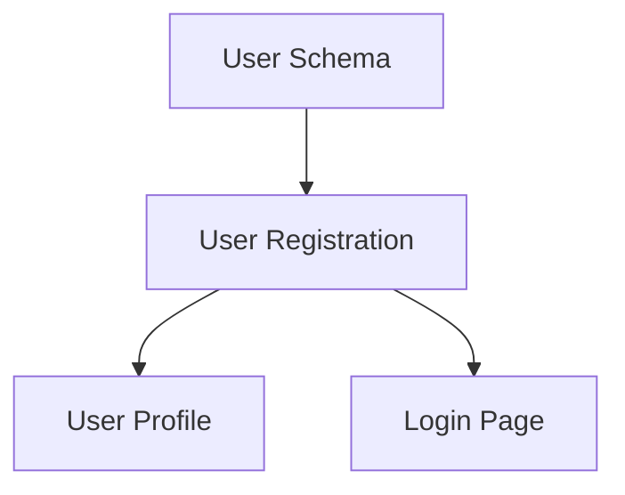

## User Input

```text
$ARGUMENTS
```

You **MUST** consider the user input before proceeding (if not empty).

## Outline

Goal: Conectar a Jira y/o Confluence APIs según el **modo** elegido, descargar los datos y **generar automáticamente el `spec.md`** sin intervención del usuario.

**Este comando hace DOS cosas en secuencia — ambas las ejecuta el agente sin parar:**
1. **Descarga** los datos de Jira y/o Confluence via script bash
2. **Genera el `spec.md`** aplicando la lógica completa de `/spec-kitti.specify` con esos datos como input

**El usuario solo escribe el comando una vez y recibe el `spec.md` final. No hay pasos manuales.**

**Modos disponibles (`--mode`):**
| Modo | Qué descarga | Parámetros requeridos |
|------|-------------|----------------------|
| `jira` | Épica + historias de Jira | `--epic-key` |
| `confluence` | Documentación de Confluence | `CONFLUENCE_SPACE_KEY` |
| `both` *(default)* | Jira + Confluence | `--epic-key` + `CONFLUENCE_SPACE_KEY` |

**Parámetros por modo:**
- `mode`: `jira` \| `confluence` \| `both` (default: `both`)
- `epic_key`: La épica de Jira (requerida en modo `jira`/`both`)
- `confluence_parent`: Página padre en Confluence (opcional — si no se pasa, descarga todo el space)

**Prerequisites:**
- Variables de entorno configuradas (JIRA_EMAIL, JIRA_API_TOKEN, JIRA_BASE_URL)
- `CONFLUENCE_SPACE_KEY` solo si se usa modo `confluence` o `both`
- O archivo `.env` con estas variables
- Network connectivity to Atlassian APIs

**Workflow Overview:**
1. Load and validate configuration
2. Authenticate with Jira and/or Confluence según el modo
3. (modo jira/both) Fetch epic + user stories from Jira
4. (modo confluence/both) Fetch Confluence pages
5. Consolidate and structure the information
6. Generate spec.md using the spec template
7. Create feature branch automatically
8. Generate import report

---

## Execution Steps

### 1. Configuration Loading

**Parse arguments from `$ARGUMENTS`:**
- `mode`: Modo de sync — `jira`, `confluence` o `both` — **OBLIGATORIO** (default: `both`)
- `epic_key`: Clave de la épica (ej: "PROJ-123") — requerida si `mode` es `jira` o `both`
- `confluence_parent`: Nombre de página padre en Confluence (ej: "API Documentation") — Opcional

**Load from environment variables:**
```bash
Required (always):
  JIRA_EMAIL              # Email de Atlassian
  JIRA_API_TOKEN          # Token de API
  JIRA_BASE_URL           # https://tu-empresa.atlassian.net

Required for mode=confluence/both:
  CONFLUENCE_SPACE_KEY    # Ej: "TECH", "DOCS", "DEV"
```

**Parse from `.env` file if exists:**
```bash
# El comando busca automáticamente .env en la raíz del proyecto
```

**Validation:**
- `JIRA_EMAIL` está configurado
- `JIRA_API_TOKEN` está configurado
- `JIRA_BASE_URL` está configurado
- `epic_key` fue proporcionado (en $ARGUMENTS o detectado automáticamente)

**Si faltan credenciales:**
```bash
ERROR: Credenciales de Jira no configuradas

Configura variables de entorno:
  export JIRA_EMAIL="tu-email@empresa.com"
  export JIRA_API_TOKEN="tu-api-token-aqui"
  export JIRA_BASE_URL="https://tu-empresa.atlassian.net"

O copia el template:
  cp .spec-kitti/.env-template .env
  # Edita .env con tus valores

Genera API token en: https://id.atlassian.com/manage-profile/security/api-tokens
```

**Si falta epic_key en modo jira/both:**
```bash
ERROR: --epic-key es requerido cuando --mode es 'jira'/'both'

Proporciona epic_key:
  /spec-kitti.sync mode=jira epic_key=PROJ-123

O especifica en el prompt:
  /spec-kitti.sync
  "Importar solo Confluence, space TECH, carpeta 'API Documentation'"
```

**Si falta CONFLUENCE_SPACE_KEY en modo confluence/both:**
```bash
ERROR: CONFLUENCE_SPACE_KEY es requerido para el modo confluence/both

Agrega al .env:
  CONFLUENCE_SPACE_KEY="TECH"
```

---

### 2. Authentication & Connection Test

**Test Jira connection:**
```http
GET {jira.base_url}/rest/api/3/myself
Authorization: Basic {base64(email:api_token)}
```

**Expected response:** `200 OK` with user details

**Test Confluence connection:**
```http
GET {confluence.base_url}/rest/api/space/{space_key}
Authorization: Basic {base64(email:api_token)}
```

**Expected response:** `200 OK` with space details

**On failure:**
- Check credentials are correct
- Verify URLs don't have typos
- Ensure API tokens are not expired
- Check network connectivity
- Verify user has permissions to access the project/space

---

### 3. Fetch Data from Jira

#### 3.1 Fetch Epic (Simplificado)

**Fetch the single epic specified by epic_key:**
```http
GET {JIRA_BASE_URL}/rest/api/3/issue/{epic_key}
?fields=summary,description,status,priority,assignee,labels,components,fixVersions,project
```

**Extract from epic:**
- Key (e.g., PROJ-123)
- Summary (title)
- Description (rich text → convert to Markdown)
- Status
- Priority
- Labels
- Components
- Fix Version
- Custom fields (if configured)

#### 3.2 Fetch ALL User Stories (Sin filtros)

**Fetch ALL stories linked to the epic (sin restricciones):**
```http
GET {JIRA_BASE_URL}/rest/api/3/search
?jql="Epic Link"={epic_key} AND type=Story
&fields=summary,description,status,priority,assignee,labels,components,customfield_10016
&maxResults=1000
```

**NO aplicar filtros** - Importar TODO:
- ✅ Todas las historias (cualquier estado)
- ✅ Todos los componentes
- ✅ Todas las prioridades
- ✅ Sin restricción de labels

**For each story, extract:**
- Key (e.g., PROJ-124)
- Summary (title)
- Description
- Acceptance Criteria (from custom field or description)
- Priority
- Story Points (if available)
- Status
- Assignee
- Labels
- Components
- Linked issues (dependencies)
- Attachments (images, diagrams, mockups)
- Comments (if include.comments = true)

#### 3.3 Organize Stories

**Group by component:**
```
Backend API:
  - PROJ-124: User authentication endpoint
  - PROJ-125: User profile endpoint

Frontend:
  - PROJ-126: Login page
  - PROJ-127: Dashboard

Database:
  - PROJ-128: User schema migration
```

**Sort by priority:**
```
P0 (Blocker) → P1 (High) → P2 (Medium) → P3 (Low)
```

**Detect dependencies:**
```
PROJ-125 (User profile) depends on PROJ-124 (Authentication)
  → Reorder stories to respect dependencies
```

---

### 4. Fetch Data from Confluence (Simplificado)

**Si `confluence_parent` está especificado en $ARGUMENTS o `CONFLUENCE_SPACE_KEY` en env:**

#### 4.1 Buscar página padre por título

```http
GET {JIRA_BASE_URL}/wiki/rest/api/content
?spaceKey={CONFLUENCE_SPACE_KEY}
&title={confluence_parent}
&expand=body.storage,version,children.page
```

#### 4.2 Descargar TODO recursivamente

**Fetch ALL child pages recursively:**
```http
GET {JIRA_BASE_URL}/wiki/rest/api/content/{parent_page_id}/child/page
?expand=body.storage,version,children.page,attachments
&limit=100
```

**Repeat recursively** para cada página hija encontrada (descargar TODO el árbol).

**Si confluence_parent NO está especificado:**
- ⚠️ Advertir pero continuar
- Solo importar de Jira
- Mensaje: "Confluence parent not specified. Skipping Confluence import."

**For each page, extract:**
- Title
- Body (HTML → convert to Markdown)
- Last modified date
- Version number
- Attachments (images, PDFs, diagrams)
- Labels

#### 4.5 Download Attachments

If `include_attachments = true`:
```http
GET {confluence.base_url}/rest/api/content/{page_id}/child/attachment
```

For each attachment:
```http
GET {confluence.base_url}{attachment.download_url}
```

Save to `.spec-kitti/confluence-attachments/{page_title}/{filename}`

---

### 5. Run the sync script

Execute the bash script and capture the JSON output:

```bash
{SCRIPT} --json \
  [--mode {mode}] \
  [--epic-key {epic_key}] \
  [--confluence-parent "{confluence_parent}"]
```

Wait for the script to finish. It will generate:
- `.spec-kitti/sync_context.md` — structured context with all downloaded data
- `.spec-kitti/import_report.md` — import summary
- `.spec-kitti/jira_raw/` — raw Jira JSON (if mode=jira/both)
- `.spec-kitti/confluence_raw/` — raw Confluence pages (if mode=confluence/both)

---

### 6. Generate spec.md — YOU (the agent) do this automatically

**CRITICAL: Do NOT ask the user to run `/spec-kitti.specify` manually. YOU execute the full specify logic right here, inline, as the next step of this command.**

Once the script finishes successfully:

1. **Read** `.spec-kitti/sync_context.md` — structured input with all downloaded Jira/Confluence data
2. **Read** `.spec-kitti/templates/spec-template.md` — required spec structure
3. **Apply the full specify logic** (from `/spec-kitti.specify`) using `sync_context.md` as the feature description:
   - Derive a short name from the epic title (if Jira) or Confluence space/parent page name
   - Run the feature setup script to create the branch + directory:
     ```bash
     {SCRIPT} --json --number {N} --short-name "{short-name}" "{feature title}"
     ```
   - Write a complete, high-quality `spec.md` to `FEATURE_DIR/spec.md`
   - Run the spec quality checklist at `FEATURE_DIR/checklists/requirements.md`
4. The spec file MUST be named exactly `spec.md`

**This is a single user action → single agent execution. Zero manual steps for the user.**

---

### 7. Output to User

**Success message after both sync + specify:**

```
✅ Sync + Spec completed!

📥 Downloaded:
   • Epic: PROJ-123 "User Management System"  (if Jira)
   • Stories: 15                               (if Jira)
   • Confluence pages: 3                       (if Confluence)

📁 Files:
   • .spec-kitti/sync_context.md    ← raw sync data
   • .spec-kitti/import_report.md   ← import summary
   • specs/001-user-management/spec.md ← generated spec

🌿 Branch: 1-user-management

Next steps:
   1. /spec-kitti.clarify  — resolve ambiguities
   2. /spec-kitti.plan     — create implementation plan
```

---

### Consolidate Information (reference only)

**Create in-memory structure:**

```json
{
  "epic": {
    "key": "PROJ-123",
    "title": "User Management System",
    "description": "Implement complete user management...",
    "priority": "High",
    "status": "In Progress"
  },
  "stories": [
    {
      "key": "PROJ-124",
      "title": "As a user, I want to register...",
      "description": "...",
      "acceptance_criteria": [
        "User can register with email and password",
        "Email verification required",
        "Password must be at least 8 characters"
      ],
      "priority": "P0",
      "story_points": 5,
      "component": "Backend API",
      "dependencies": [],
      "attachments": [...]
    }
  ],
  "confluence_pages": [
    {
      "title": "API Design Guidelines",
      "content": "...",
      "attachments": [...]
    }
  ]
}
```

**Apply transformations:**
- Convert Jira's ADF (Atlassian Document Format) → Markdown
- Convert Confluence HTML → Markdown
- Extract inline images and save locally
- Resolve cross-references between stories
- Extract implicit non-functional requirements (e.g., "must be fast" → performance requirement)

---

### 6. Generate spec.md

**Use the spec template** (`.spec-kitti/templates/spec-template.md`) and populate:

#### Header Section
```markdown
# Feature Specification: [Epic Title]

**Jira Epic:** [PROJ-123](https://empresa.atlassian.net/browse/PROJ-123)  
**Status:** [Epic Status]  
**Priority:** [Epic Priority]  
**Last Updated:** [Import Date]

---
```

#### Context Section
```markdown
## Context

[Epic Description from Jira - converted to Markdown]

### Source Documentation

- **Jira Epic:** [PROJ-123](link)
- **Confluence Pages:**
  - [API Design Guidelines](link)
  - [Architecture Overview](link)
- **Total Stories:** X stories (Y story points)

---
```

#### User Stories Section
```markdown
## User Stories

### Story 1: [PROJ-124] User Registration

**Priority:** P0 (Blocker)  
**Story Points:** 5  
**Component:** Backend API  
**Jira Link:** [PROJ-124](link)

**Description:**
As a new user, I want to register for an account so that I can access the platform.

**Acceptance Criteria:**
- [ ] User can register with email and password
- [ ] Email verification required before account activation
- [ ] Password must be at least 8 characters with 1 uppercase, 1 number
- [ ] Duplicate email addresses are rejected
- [ ] User receives welcome email after successful registration

**Dependencies:**
- PROJ-128 (User schema must be created first)

**Attachments:**
- [Registration Flow Diagram](./confluence-attachments/registration-flow.png)

---

### Story 2: [PROJ-125] User Profile...
[Repeat for each story]
```

#### Technical Context (from Confluence)
```markdown
## Technical Context

[Content from Confluence pages - converted to Markdown]

### API Design Guidelines
[Content from Confluence]

### Architecture Overview
[Content from Confluence]

---
```

#### Functional Requirements (extracted)
```markdown
## Functional Requirements

Based on the user stories above, the following functional requirements are identified:

1. **FR-001: User Registration**
   - System must allow new users to register with email/password
   - Email verification required
   - Password complexity enforcement

2. **FR-002: User Authentication**
   - System must support JWT-based authentication
   - Tokens expire after 24 hours
   
[Continue extracting from all stories]
```

#### Non-Functional Requirements (extracted)
```markdown
## Non-Functional Requirements

### Performance
- User registration must complete within 2 seconds
- Authentication endpoint must respond within 500ms

### Security
- Passwords must be hashed with bcrypt (cost factor 12)
- JWTs must use RS256 algorithm
- All endpoints require HTTPS

### Scalability
- System must support 10,000 concurrent users
- Database must handle 1000 writes/second

[Extract implicit NFRs from story descriptions and Confluence docs]
```

#### Edge Cases
```markdown
## Edge Cases & Error Handling

1. **Duplicate Registration Attempts**
   - User tries to register with existing email
   - Expected: 409 Conflict with clear error message

2. **Invalid Email Format**
   - User provides malformed email
   - Expected: 400 Bad Request with validation error

[Extract from acceptance criteria and comments]
```

#### Dependencies
```markdown
## Dependencies



**Critical Path:**
1. PROJ-128 (Database schema) - **MUST complete first**
2. PROJ-124 (Registration API)
3. PROJ-125, PROJ-126 (can be parallel)
```

#### Appendix
```markdown
## Appendix

### Import Metadata

- **Import Date:** 2026-01-29 15:30:00
- **Jira Project:** PROJ
- **Epic:** PROJ-123
- **Stories Imported:** 15
- **Confluence Pages:** 3
- **Attachments:** 8 files

### Raw Links

- **Jira JQL:** `project=PROJ AND epic=PROJ-123 AND type=Story`
- **Confluence Space:** TECH

---

*This specification was auto-generated from Jira and Confluence. Manual edits will be preserved.*
```

---

### 7. Create Feature Branch

**Run the setup script** with extracted feature name:

```bash
{SCRIPT} --json --number auto --short-name "{feature-name}" "{epic-title}"
```

**Parse JSON output** to get:
- `BRANCH_NAME`
- `FEATURE_DIR`
- `SPEC_FILE`

**Write spec.md** to `FEATURE_DIR/spec.md`

---

### 8. Generate Import Report

**Create** `.spec-kitti/import-report.md`:

```markdown
# Jira/Confluence Import Report

**Import Date:** 2026-01-29 15:30:00  
**Duration:** 45 seconds

## Summary

✅ **Successfully imported from Jira:**
- Epic: PROJ-123 "User Management System"
- Stories: 15 (total 85 story points)
- Attachments: 12 files

✅ **Successfully imported from Confluence:**
- Pages: 3
- Attachments: 8 files

## Breakdown by Component

| Component | Stories | Story Points | Priority Distribution |
|-----------|---------|--------------|----------------------|
| Backend API | 6 | 35 | P0: 2, P1: 3, P2: 1 |
| Frontend | 5 | 30 | P0: 1, P1: 2, P2: 2 |
| Database | 2 | 10 | P0: 2 |
| DevOps | 2 | 10 | P2: 2 |

## Validation Results

✅ All stories have acceptance criteria  
✅ All stories in valid status  
⚠️ 2 stories missing story points estimation  
⚠️ 1 story has no assignee

## Missing or Incomplete Data

- **PROJ-127:** Missing acceptance criteria → added placeholder
- **PROJ-130:** No story points → marked as "TBD"
- **PROJ-131:** Status "Closed" (filtered out per config)

## Generated Files

- `specs/003-user-management/spec.md` (main specification)
- `.spec-kitti/confluence-attachments/` (8 files downloaded)
- `.spec-kitti/import-report.md` (this file)

## Next Steps

1. Review `spec.md` for completeness
2. Run `/spec-kitti.clarify` to resolve ambiguities
3. Run `/spec-kitti.plan` to create implementation plan

---

*Config used: `.spec-kitti/jira-config.yml`*
```

---

### 9. Output to User

**Success message:**

```
✅ Import completed successfully!

📊 Summary:
   • Epic: PROJ-123 "User Management System"
   • Stories: 15 (85 story points)
   • Confluence pages: 3
   • Attachments: 8 files downloaded

📁 Files created:
   • specs/003-user-management/spec.md
   • .spec-kitti/import-report.md
   • .spec-kitti/confluence-attachments/ (8 files)

🌿 Branch created: 3-user-management

📋 Validation:
   ✅ All stories have acceptance criteria
   ⚠️  2 stories missing story points

Next steps:
   1. Review spec.md: cat specs/003-user-management/spec.md
   2. Clarify ambiguities: /spec-kitti.clarify
   3. Create plan: /spec-kitti.plan
```

---

## Error Handling

### API Rate Limiting

**If 429 Too Many Requests:**
- Respect `Retry-After` header
- Implement exponential backoff
- Reduce `max_concurrent_requests` in config
- Increase `request_delay_ms`

### Missing Data

**If epic not found:**
```
ERROR: Epic PROJ-123 not found in Jira

Possible reasons:
  • Epic key is incorrect
  • You don't have permission to view this epic
  • Epic has been deleted

Verify epic exists: https://empresa.atlassian.net/browse/PROJ-123
```

**If no stories found:**
```
WARNING: No stories found for epic PROJ-123

Possible reasons:
  • No stories are linked to this epic yet
  • Stories are filtered out by your config (check valid_story_statuses)
  • JQL query is too restrictive

Check stories in Jira: https://empresa.atlassian.net/browse/PROJ-123
```

### Confluence Access

**If page not found:**
```
WARNING: Confluence page "API Design" not found in space TECH

Continuing with partial import...
  • Skipping this page
  • Spec will be generated without Confluence documentation
```

### Network Issues

**If connection fails:**
```
ERROR: Cannot connect to Jira API

Please check:
  • Network connectivity
  • VPN connection (if required)
  • Firewall settings
  • Base URL is correct

Retry with: /spec-kitti.import.jira --retry
```

---

## Behavior Rules

- **Respect rate limits**: Add delays between requests
- **Handle pagination**: Fetch all stories (not just first 100)
- **Preserve formatting**: Maintain Markdown structure from Confluence
- **Link preservation**: Keep all Jira/Confluence links intact
- **Idempotent**: Re-running should update spec, not duplicate
- **Incremental**: If spec exists, offer to merge or replace
- **Validation**: Warn about missing data but don't fail
- **Cache**: Store raw API responses for debugging (if enabled)

---

## Advanced Options

### Merge Mode

If spec.md already exists:

```
⚠️  Specification already exists: specs/003-user-management/spec.md

Options:
  [M] Merge - Update with new stories from Jira
  [R] Replace - Overwrite completely
  [C] Cancel - Abort import

Your choice [M/R/C]:
```

### Dry Run Mode

```bash
/spec-kitti.import.jira --dry-run

# Shows what would be imported without creating files
```

### Custom Mapping

Override field mapping in command:

```bash
/spec-kitti.import.jira epic_key=PROJ-123 --map "custom_field_10100=acceptance_criteria"
```

---

## Quick Reference — Examples

```bash
# Solo Jira (épica + historias)
/spec-kitti.sync mode=jira epic_key=PROJ-123

# Solo Confluence (sin Jira)
/spec-kitti.sync mode=confluence confluence_parent="API Documentation"

# Solo Confluence — todo el space (sin página padre)
/spec-kitti.sync mode=confluence

# Ambos (default)
/spec-kitti.sync mode=both epic_key=PROJ-123 confluence_parent="API Documentation"

# Ambos sin especificar página padre (descarga todo el space de Confluence)
/spec-kitti.sync epic_key=PROJ-123
```

## Context

{ARGS}

